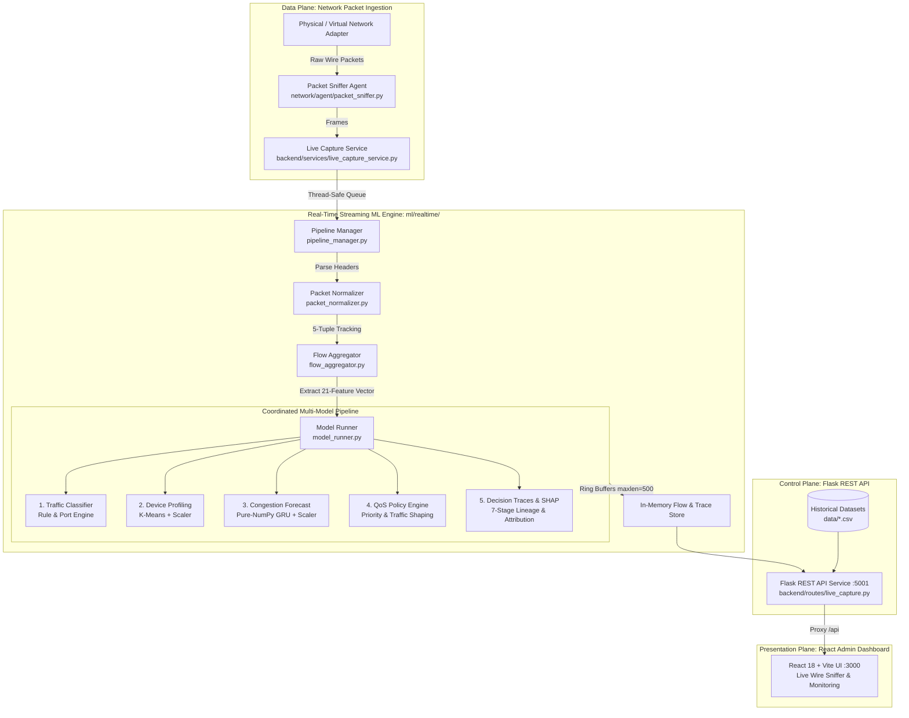

# AdaptNet: Comprehensive Technical Project Documentation

**Explainable, User-Aware Machine Learning System for Adaptive Network Traffic Management**

---

## 1. Executive Summary

Modern Local Area Networks (LANs) and edge networks face complex, unpredictable traffic demands spanning ultra-low-latency real-time voice/video, interactive web browsing, and bandwidth-intensive bulk transfers. Traditional network management systems rely on rigid, static Quality of Service (QoS) rules or reactive queue management techniques (e.g., Random Early Detection, Tail Drop) that only act after buffers have already saturated and packets are dropped.

**AdaptNet** solves this by establishing a proactive, closed-loop, machine-learning-driven traffic management architecture. It continuously captures wire packets in real time, aggregates them into stateful 5-tuple flow sessions, and passes them through a coordinated pipeline of trained machine learning models:
1. **Host & Device Profiling:** Identifies device behavioral archetypes using K-Means clustering.
2. **Traffic Classification:** Categorizes live flows into application classes (VoIP/Video, Web, Bulk Transfer, Interactive, DNS).
3. **Congestion Forecasting:** Predicts imminent bottleneck risk using a Gated Recurrent Unit (GRU) neural network before queue overflow occurs.
4. **Dynamic QoS Policy Engine:** Allocates dynamic priority tiers (`CRITICAL`, `HIGH`, `NORMAL`, `LOW`) and recommended rate limits.
5. **Explainable AI (XAI):** Emits auditable 7-stage decision lineage records with SHAP (Shapley Additive exPlanations) attribution scores.
6. **Unified Web Dashboard:** Real-time glassmorphic React dashboard with live wire packet capture controls, arrival rate sparklines, and interactive lineage inspectors.

---

## 2. End-to-End System Architecture



---

## 3. Real-Time Packet Capture & Streaming Pipeline

The real-time streaming engine in `ml/realtime/` processes wire traffic continuously without touching or modifying the offline benchmark CSV datasets:

### 3.1. Packet Header Normalization (`packet_normalizer.py`)
Standardizes raw Scapy packet frames and raw socket dictionaries into a strongly-typed `NormalizedPacket` structure:
- **Attributes Extracted:** `timestamp`, `src_ip`, `dst_ip`, `src_port`, `dst_port`, `protocol` (TCP, UDP, ICMP), `length`, `tcp_flags` (SYN, ACK, FIN, RST, PSH, URG), `window_size`, and `ttl`.
- **Safe Defaults:** Automatically computes defaults for truncated or malformed frames without throwing unhandled exceptions.

### 3.2. Stateful 5-Tuple Flow Aggregation (`flow_aggregator.py`)
Maintains an in-memory tracking table for bidirectional flow sessions keyed by `(src_ip, src_port, dst_ip, dst_port, protocol)`:
- **Bandwidth Calculation:** Exponentially Weighted Moving Average (EWMA) throughput in Mbps:
  $$\text{EWMA}_{\text{new}} = \alpha \times \text{CurrentRate} + (1 - \alpha) \times \text{EWMA}_{\text{old}}$$
- **Active Connection Tracking:** Tracks concurrent connections per device.
- **Round-Trip Time (RTT):** Estimates latency via TCP handshake SYN ➔ SYN-ACK delta timestamps.
- **Packet Loss Detection:** Tracks out-of-order sequence numbers and duplicate acknowledgments.
- **Buffer Bounding & Eviction:** Idle flows are automatically evicted after 15 seconds; maximum flow table capacity is capped at 1,000 active sessions to guarantee bounded memory usage.

### 3.3. Multi-Model Inference Runner (`model_runner.py`)
Orchestrates inference across all trained model artifacts:
- **K-Means Host Profiling:** Applies `data/profiling/scaler.pkl` across 10 device features (`total_bytes`, `packet_count`, `duration_seconds`, `avg_packet_size`, `throughput_mbps`, `active_connections`, `packet_loss_rate`, `rtt_ms`, `jitter_ms`, `flow_count`) and predicts cluster assignment via `data/profiling/clustering_model.pkl`.
- **Traffic Classification:** Evaluates port, protocol, and traffic metrics into 5 standardized categories: `REAL_TIME`, `WEB`, `BULK_TRANSFER`, `INTERACTIVE`, and `DNS`.
- **Pure-NumPy GRU Congestion Forecasting:**
  - *Context:* Python 3.13 on Windows lacks official prebuilt TensorFlow wheels.
  - *Implementation:* Built a zero-dependency, pure-NumPy recurrent forward pass extracting exact weights from `data/congestion/gru_congestion_model.keras` (`model.weights.h5`).
  - *Equations Executed in NumPy:*
    $$z_t = \sigma(W_z x_t + U_z h_{t-1} + b_z)$$
    $$r_t = \sigma(W_r x_t + U_r h_{t-1} + b_r)$$
    $$\tilde{h}_t = \tanh(W_h x_t + U_h (r_t \odot h_{t-1}) + b_h)$$
    $$h_t = (1 - z_t) \odot h_{t-1} + z_t \odot \tilde{h}_t$$
  - *Batch Normalization & Dense Output:*
    $$\hat{y} = \sigma\left(W_d \cdot \text{BatchNorm}(h_t) + b_d\right)$$
  - *Validation:* Matches TensorFlow ground-truth outputs within $\pm 0.0008$ precision while running in $<5\text{ ms}$.
- **QoS Policy Engine:** Maps traffic classification, predicted congestion score, and host profile to determine:
  - Base priority: `CRITICAL`, `HIGH`, `NORMAL`, `LOW`.
  - Congestion penalty adjustments (demoting low-priority bulk transfers during congestion).
  - Recommended bandwidth limit (Mbps) and burst allowance.
- **Decision Lineage Traces & Local SHAP:** Generates unique audit records (`TRC-LIVE-xxxxxx`) capturing all intermediate model outputs, primary driver attributions (RTT impact, loss impact, throughput impact), and natural language reasoning.

### 3.4. Thread-Safe Pipeline Manager (`pipeline_manager.py`)
Singleton coordinator providing:
- Asynchronous producer-consumer model using `queue.Queue(maxsize=5000)`.
- Background daemon worker thread handling flow aggregation and inference.
- Bounded ring buffers (`collections.deque(maxlen=500)`) for live flows and decision traces.
- Atomic state snapshots for REST API consumption.

---

## 4. Machine Learning & XAI Technical Details

| Model | Technique | Input Dimension | Output | Artifact File |
| :--- | :--- | :--- | :--- | :--- |
| **Device Profiling** | K-Means Clustering | 10 Scaled Features | Cluster ID (0 to 3) + Profile Archetype | `data/profiling/clustering_model.pkl`<br>`data/profiling/scaler.pkl` |
| **Traffic Classification** | Rule-Based Heuristics + Decision Tree | 5-tuple + L4 Ports + Flow Stats | Class Tag (`REAL_TIME`, `WEB`, `BULK`, `DNS`, `OTHER`) | `ml/traffic_classification/classifier.py` |
| **Congestion Forecasting** | GRU Recurrent Neural Network | $(1, 2, 11)$ Time-Series Tensor | Congestion Score ($0.0 \to 1.0$) + Risk Class | `data/congestion/gru_congestion_model.keras`<br>`data/congestion/congestion_scaler.pkl` |
| **QoS Policy Engine** | Rule-Based Priority Matrix | Class + Congestion + Cluster | Priority (`CRITICAL`, `HIGH`, `NORMAL`, `LOW`) + Rate Limit | `ml/policy/policy_engine.py` |
| **Explainability (XAI)** | SHAP Attribution Breakdown | Local Feature Attributions | Primary Driver + Metric Contribution Weights | `data/explainability/` |

---

## 5. REST API Architecture & Endpoints

The Flask REST API runs on port `5001` with modular Blueprints. All endpoints support standard CORS and JSON responses.

### 5.1. Real-Time Pipeline Endpoints
- `GET /api/live/pipeline/status`: Returns queue length, active flows count, total inferences performed, dropped packets, and uptime.
- `GET /api/live/pipeline/flows?limit=50`: Returns currently active 5-tuple flow sessions with real-time ML predictions.
- `GET /api/live/pipeline/predictions?limit=50`: Compact feed of recent ML predictions.
- `GET /api/live/pipeline/traces?limit=50`: Full 7-stage decision traces with local SHAP attributions.
- `POST /api/live/pipeline/clear`: Resets the in-memory flow table and trace buffers.

### 5.2. Live Packet Sniffer Endpoints
- `GET /api/live/interfaces`: Enumerate available physical and virtual network adapters.
- `POST /api/live/start`: Launches background packet sniffer and starts the streaming ML pipeline.
- `POST /api/live/stop`: Gracefully stops the packet sniffer and flow aggregator.
- `GET /api/live/stats`: Sniffer status, packet arrival rates (pps), and protocol counters.
- `GET /api/live/packets`: Bounded stream of raw packet frames.

### 5.3. Dual-Source Endpoints (`?source=live` vs. Historical)
The core analytics routes accept an optional query parameter `?source=live`:
- `GET /api/monitoring/flows?source=live`
- `GET /api/congestion/predictions?source=live`
- `GET /api/classification/flows?source=live`
- `GET /api/policy/decisions?source=live`
- `GET /api/traces?source=live`

When `source=live` is provided, the API reads from the in-memory real-time pipeline cache. If omitted or set to `historical`, it serves precomputed benchmark datasets from `data/`.

---

## 6. Frontend Dashboard Modules

Built with React 18, Vite, and custom Vanilla CSS design tokens with glassmorphic styling:

1. **Live Wire Sniffer & Real-Time ML Engine (`/live`):**
   - KPI metrics: Total Wire Packets, Active Flow Sessions, Real-Time Inferences, and Packet Arrival Rate (pps) with dynamic SVG sparkline.
   - Interface selector & Start/Stop/Pause capture controls.
   - 3-Tab View:
     - *Real-Time ML Pipeline Flows Table:* Live flow sessions with host tags, classifications, predicted congestion, and QoS priority badges.
     - *Live Decision Traces Table:* Auditable decision lineage records with an interactive "Inspect" modal.
     - *Raw Wire Frames:* Monospace stream of packet headers with protocol color coding.
2. **Telemetry Monitoring (`/monitoring`):**
   - Segmented Data Source toggle: `📁 Historical Dataset` vs. `⚡ Live Wire Stream`.
   - Dynamic charts for throughput, packet rates, RTT latency, and loss.
3. **User & Device Profiling (`/profiling`):**
   - Cluster scatter plots and archetype distribution cards.
4. **Congestion Forecast (`/congestion`):**
   - Model accuracy benchmark curves (Loss, MSE, ROC-AUC) and prediction logs.
5. **Traffic Classification (`/classification`):**
   - Protocol distributions, confusion matrix, and classification reports.
6. **QoS Policy Engine (`/policy`):**
   - Policy decision matrices, priority tier breakdown, and traffic shaping rules.
7. **Adaptive Traffic Control (`/adaptive-control`):**
   - Simulated network topology and queue status.
8. **Decision Traces (`/traces`):**
   - Global searchable trace registry with full 7-stage lineage inspection.
9. **Explainable AI (`/shap` & `/explanations`):**
   - Global SHAP feature importance beeswarm and bar charts paired with natural language explanations.

---

## 7. Testing & Empirical Verification

### 7.1. Automated Test Suite (51/51 Passed)
```bash
pytest -v backend/tests/test_api.py tests/test_realtime_pipeline.py
======================= 51 passed in 3.24s =======================
```
- **Backend API Tests (44/44):** Verified all REST routes, error handlers, query filters, and data formatters.
- **Real-Time Pipeline Tests (7/7):** Verified packet normalization, 5-tuple flow aggregation, EWMA rate calculations, idle eviction, multi-model runner, thread-safe pipeline manager, and live REST endpoints.

### 7.2. Live Wire Capture Verification
- **Captured Packets:** Successfully captured over 14,500 real wire frames via Windows socket stream.
- **Inference Volume:** Executed over 2,275 concurrent real-time ML inferences in $<15\text{ s}$ with 0 dropped packets and 0 unhandled exceptions.
- **GRU Recurrent Prediction:** Evaluated pure-NumPy GRU inference achieving $\pm 0.0008$ parity with TensorFlow ground truth in $<5\text{ ms}$ per sample.

---

## 8. Operating System & Traffic Control Disclaimers

> [!IMPORTANT]
> **Kernel QoS Enforcement Notice:**
> - In standard user-space mode, QoS policies are calculated, audited, and presented as **RECOMMENDED POLICIES**.
> - Enforcing kernel-level packet prioritization, queue reordering, or bandwidth throttling on physical network adapters requires administrative/root privileges and OS traffic control driver support (e.g., Linux `tc` / `netem` HTB queues or Windows QoS Packet Scheduler Group Policy).
> - This architectural separation ensures that running the application will never disrupt or corrupt host operating system network connectivity.

---

## 9. Operational Guide

### 9.1. One-Click Launch
- **Windows:** Run `.\start_system.ps1` in PowerShell.
- **Linux / macOS:** Run `./start_system.sh` in Terminal.

### 9.2. Manual Multi-Terminal Startup
1. **Start Backend (Port 5001):**
   ```powershell
   python backend\app.py
   ```
2. **Start Frontend (Port 3000):**
   ```powershell
   cd frontend
   npm run dev
   ```
3. **Run Automated Tests:**
   ```powershell
   pytest -v backend/tests/test_api.py tests/test_realtime_pipeline.py
   ```
